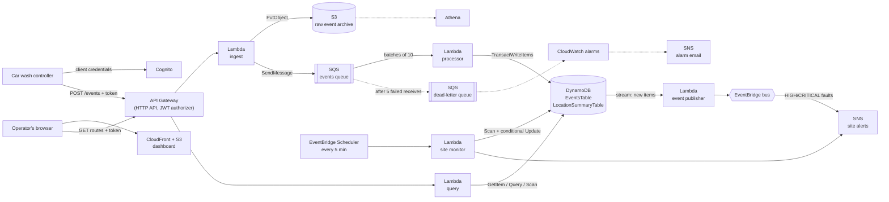
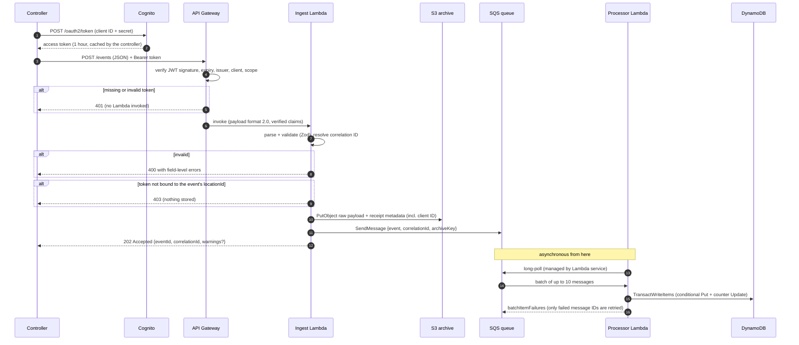

# WashOps: Serverless Car Wash Event Integration Service

An event-driven integration layer on AWS that ingests operational events from car wash equipment controllers (washes, payments, equipment faults, heartbeats), archives every raw payload, processes events asynchronously and idempotently, publishes them to other systems, detects sites that go offline, and exposes per-location operational summaries through an authenticated HTTP API and a web dashboard.

Built with **TypeScript**, **AWS Lambda (Node.js 22)**, **API Gateway**, **Cognito**, **SQS + dead-letter queue**, **S3**, **DynamoDB (+ Streams)**, **EventBridge (bus, rules, Scheduler)**, **CloudWatch**, **X-Ray**, **CodeDeploy**, **Athena**, **CloudFront**, and **IAM**, defined entirely as infrastructure as code with **AWS SAM**.

> **Status:** the core pipeline (ingest → S3 + SQS → processor → DynamoDB → query API, with the DLQ and alarms) is deployed to a personal AWS account (us-east-1) and verified end to end, including duplicate delivery and a poison message flowing through retries into the DLQ.
>
> Later rounds of features are **built and tested locally but not yet deployed**: API authentication with per-site credentials, controller clock checks, offline-site detection, EventBridge fan-out, canary deploys, dev and prod environments, the GitHub OIDC pipeline with integration tests, the replay tool, Athena, the extra alarms and dashboard, and the web dashboard. They are marked *(not yet deployed)* below until they have been verified in AWS. Anything conceptual is listed under [future improvements](#future-production-improvements).

---

## Contents

- [Business problem](#business-problem)
- [Architecture](#architecture)
- [AWS services and why each exists](#aws-services-and-why-each-exists)
- [Request flow](#request-flow)
- [Asynchronous processing](#asynchronous-processing)
- [Reliability and failure handling](#reliability-and-failure-handling)
- [Idempotency](#idempotency)
- [Controller clocks](#controller-clocks)
- [Offline site detection](#offline-site-detection)
- [Event fan-out with EventBridge](#event-fan-out-with-eventbridge)
- [Security and IAM](#security-and-iam)
- [Data model](#data-model)
- [Observability](#observability)
- [Querying the archive with Athena](#querying-the-archive-with-athena)
- [Operations dashboard](#operations-dashboard)
- [Runbook](#runbook)
- [Local development](#local-development)
- [Testing](#testing)
- [Environments](#environments)
- [AWS deployment](#aws-deployment)
- [CI/CD](#cicd)
- [API reference and examples](#api-reference-and-examples)
- [Design decisions](#design-decisions)
- [Tradeoffs](#tradeoffs)
- [Future production improvements](#future-production-improvements)

---

## Business problem

A car wash site is a set of physical systems: tunnel controllers, pay stations, dryers, pumps. Each produces a stream of events that business software needs: wash volume, revenue, equipment health, and whether the site is even online.

That integration layer has to cope with the realities of edge devices:

- **Unreliable networks.** Controllers retry, so the same event can arrive more than once.
- **Bursty traffic.** A Saturday morning looks nothing like a Tuesday night.
- **Downstream failures.** A database hiccup must not cause lost transactions or failed requests at the site.
- **Auditability.** When a revenue number looks wrong, someone needs to see exactly what the controller sent.
- **Silence.** A site whose internet connection drops sends nothing at all, so no error ever reaches the system.

WashOps accepts events quickly, stores the original payload durably, processes each event exactly once into queryable operational state, tells other systems about it, and notices when a site goes quiet.

## Architecture



The write path (ingest) and the read path (query) are separate Lambdas with separate IAM roles. The API never waits on DynamoDB, so a slow or failing processor cannot cause failed requests at the car wash. Everything downstream of DynamoDB (fan-out, alerts) hangs off the table's stream, so it never slows down or endangers processing.

## AWS services and why each exists

| Service | Role in WashOps | Without it |
|---|---|---|
| **API Gateway (HTTP API)** | Managed HTTPS front door: routing, TLS, throttling, access logs, and JWT verification. Invokes Lambda per request. | We'd run and patch a web server fleet, load balancer, and TLS termination ourselves. |
| **Amazon Cognito** | Issues tokens: client credentials for controllers (machines), hosted sign-in for dashboard users (people). API Gateway checks every token before any Lambda runs. | Hand-rolled API keys, password storage, and token signing. |
| **AWS Lambda** | Runs stateless handlers on demand; scales by running more concurrent copies; billed per millisecond. | Always-on servers sized for peak load, sitting idle overnight. |
| **Amazon SQS** | Durable buffer that decouples ingestion from processing. Messages survive processor outages for up to 4 days (configured). | Ingestion would call the database synchronously; any downstream failure becomes a failed or lost event. |
| **SQS dead-letter queue** | Quarantines messages that fail repeatedly so they stop consuming retries and can be inspected and redriven. | A poison message retries until it expires and is silently lost, or blocks attention from real failures. |
| **Amazon S3** | Low-cost, highly durable, versioned archive of every raw payload as received: audit trail and replay source. Also hosts the dashboard's static files. | No record of what a controller actually sent once validation or processing transforms it. |
| **Amazon DynamoDB** | Serverless key-value store for processed events and pre-aggregated location summaries; conditional writes provide idempotency; the stream feeds the event publisher. | Managing database capacity, connections, and patching; connection pooling problems from many concurrent Lambdas. |
| **Amazon EventBridge** | A bus other systems subscribe to with rules (maintenance, loyalty, BI); an archive for replaying events to new subscribers; Scheduler runs the site monitor. | Every new consumer would need a code change in this service. |
| **Amazon CloudWatch** | Centralized logs (Logs Insights over structured JSON), metrics (including custom ones from logs), alarms, and a dashboard. | No visibility into a distributed system spanning six functions, two queues, and a stream. |
| **AWS X-Ray** | Per-invocation traces: where time goes (cold start vs. handler), linked across the SQS hop. | Guessing at latency from log timestamps. |
| **AWS CodeDeploy** | Shifts traffic to each new Lambda version gradually and rolls back automatically if an alarm fires. | A bad deploy hits 100% of traffic at once. |
| **Amazon Athena + Glue** | SQL over the raw S3 archive where it sits (nothing copied). | Downloading objects to answer "how many washes did miami-01 do last Tuesday?". |
| **Amazon CloudFront** | Serves the dashboard over HTTPS from a private bucket, with security headers. | A public bucket, or a web server just for static files. |
| **Amazon SNS** | Delivers alarm and site alert notifications by email. | Alarms change state in the console but nobody is told. |
| **AWS IAM** | A dedicated execution role per function, scoped to exactly the resources it uses; an OIDC trust for GitHub Actions. | Shared or wildcard credentials: one bug or compromise could touch everything. |
| **AWS SAM / CloudFormation** | The whole environment (96 resources after the SAM transform) defined in `template.yaml`: reviewable, repeatable, and removable with one command. | Hand-built console resources that drift and can't be reproduced or code-reviewed. |

## Request flow



1. **Authenticate at the gateway** *(not yet deployed)*. API Gateway's JWT authorizer rejects requests without a valid Cognito token (`401`) or without the route's scope (`403`) before any Lambda runs, so unauthenticated traffic costs nothing.
2. **Validate at the edge.** The body is parsed and validated against a discriminated union of five event schemas. Timestamps are normalized to UTC, and money must have at most two decimal places.
3. **Check the site** *(not yet deployed)*. The token must carry `washops/site.<locationId>` for the event's location, or ingest returns `403` and stores nothing. See [Security and IAM](#security-and-iam).
4. **Check the clock** *(not yet deployed)*. A timestamp far from server time is accepted but flagged, with a warning in the response. See [Controller clocks](#controller-clocks).
5. **Correlation ID.** A caller-supplied `x-correlation-id` is reused if well-formed; otherwise a UUID is generated. It is returned in the response, carried through SQS, logged by every function, and stored on the DynamoDB item.
6. **Archive first, then enqueue.** Every message on the queue therefore has a raw S3 record behind it, including which client credential sent it.
7. **Return `202 Accepted`.** The contract is "durably received", not "processed".

## Asynchronous processing

The processor is triggered by an **SQS event source mapping**: the Lambda service long-polls the queue on the function's behalf, using the function's IAM role, and invokes it with batches of up to 10 messages.

- **Partial batch responses** (`ReportBatchItemFailures`): the handler returns only the IDs of messages that failed. Successful messages in the same batch are deleted instead of being reprocessed.
- **Visibility timeout (60 s):** a received message is hidden from other consumers while it is being processed. It is 6× the function timeout, per AWS guidance, so a slow invocation doesn't cause the same message to be delivered to a second consumer mid-flight.
- **Bounded concurrency** (`MaximumConcurrency: 5`): caps parallel consumers so a large backlog drains steadily instead of stampeding downstream systems.
- **Measured latency:** warm processing took roughly 60–150 ms from `receivedAt` to `processedAt`; cold starts added about 0.4–0.5 s of init time per function.

## Reliability and failure handling

| Scenario | What happens | Verified |
|---|---|---|
| **Invalid event** | Ingest returns `400` with every field error at once. Nothing is written to S3, SQS, or DynamoDB. | ✅ deployed + unit test |
| **Missing or invalid token** | API Gateway returns `401`; no Lambda runs. A valid token without the route's scope gets `403`. | Not yet deployed |
| **A site's credential used for another site** (misconfigured or stolen) | Ingest returns `403` before archiving or enqueueing; nothing is stored or counted. | Unit + integration test; not yet deployed |
| **Controller clock is wrong** | The event is accepted (the wash still happened), flagged with `clockSkewSeconds`, sorted by receipt time, and the `controller-clock-skew` alarm fires. Liveness uses server time, so offline detection isn't fooled. | Unit + integration test; not yet deployed |
| **Ingestion Lambda crashes or times out** | API Gateway returns `5xx`; nothing was acknowledged, so the controller retries. If S3/SQS had already succeeded, the retry produces a duplicate message, which the processor dedupes. | Design |
| **S3 unavailable** | The SDK retries transient errors (3 attempts, exponential backoff with jitter). If it still fails, ingest returns `500` and does **not** enqueue, preserving "every queued event is archived". | ✅ unit test |
| **SQS temporarily unavailable** | SDK retries; then `500` to the controller, which retries. The already-written S3 object remains as a harmless receipt of the failed attempt. | Design |
| **Processor throws** (bug, DynamoDB error) | That message is reported in `batchItemFailures`, stays on the queue, and reappears after the visibility timeout for another attempt. Other messages in the batch are unaffected. | ✅ unit test |
| **Poison message** (can never succeed) | Fails on every receive. After `maxReceiveCount` (now 5) SQS moves it to the DLQ with its original body and ID; the DLQ alarm notifies via SNS. | ✅ deployed with `maxReceiveCount` 3: 3 attempts ~60 s apart, moved to DLQ, alarm fired ~2.5 min later |
| **Same event delivered twice** | The conditional write detects the existing `eventId`, the transaction is cancelled, and the processor logs `DUPLICATE` and acknowledges the message. Counters are unchanged, and nothing is published twice. | ✅ deployed + unit test |
| **DynamoDB throttling or errors** | SDK retries first; persistent failure fails that message only, and SQS retries it later. Because each write is one atomic transaction, a retry can never leave a half-applied update. Sustained failure lands messages in the DLQ for redrive after recovery. | ✅ unit test |
| **Processing stalled** (bad deploy, permissions) | Messages accumulate on the queue (4-day retention). The `processing-stalled` alarm fires when the oldest message is over 5 minutes old. | Design |
| **EventBridge rejects or is unavailable** | The publisher reports the affected stream records as failed; Lambda retries from the first failure (up to 5 times, splitting the batch to isolate a bad record). After that, the batch's location is sent to the publisher-failures queue and its alarm fires; the [runbook](#runbook) republishes the events. | Unit test; not yet deployed |
| **A site goes silent** | The site monitor marks it `OFFLINE` and emails once; when heartbeats resume it marks it `ONLINE` and emails once more. | Unit test; not yet deployed |
| **Site alert email fails to send** | The monitor undoes the recorded change and fails the run, so the next run (or Scheduler's retry) sends it. | Unit test; not yet deployed |
| **A deploy introduces errors** | CodeDeploy is shifting traffic to the new version; the `lambda-errors` or `error-logs` alarm fires and CodeDeploy rolls the alias back to the previous version. | Not yet deployed |
| **Accidental delete of data** | Tables have point-in-time recovery (35 days) and survive a stack delete; archive objects are versioned (deleted or overwritten objects recoverable for 7 days). | Not yet deployed |

## Idempotency

Standard SQS guarantees **at-least-once** delivery. Duplicates are normal in distributed systems: a Lambda can time out after writing to DynamoDB but before SQS records the deletion, a controller can retry after a network blip swallowed our `202`, and SQS itself may occasionally deliver a message twice.

WashOps makes processing safe to repeat:

```text
TransactWriteItems (all-or-nothing)
 ├─ Put    EventsTable[eventId]           IF attribute_not_exists(eventId)   ← idempotency record
 └─ Update LocationSummaryTable[location] ADD completedWashes 1, washRevenueCents 2200
```

- The **event record and the counter increment commit atomically.** Writing them separately would open a window where a crash either loses the increment or double-counts on retry.
- If the `eventId` already exists, DynamoDB cancels the transaction with `ConditionalCheckFailed` on item 0. The processor treats that as success (`DUPLICATE`) so SQS deletes the message instead of retrying it.
- **Heartbeats take a different path on purpose.** "Move `lastHeartbeat` forward to T" is *naturally* idempotent, so it uses a single conditional update (`lastHeartbeat < :ts`). That also prevents an out-of-order, older heartbeat from moving the value backwards, since standard SQS does not guarantee ordering. T is the server's receipt time *(not yet deployed; previously the controller's timestamp)*, so a controller's wrong clock can't affect liveness.
- Money is stored as **integer cents** (`19.99 * 100 === 1998.9999999999998` in JavaScript).
- The same idea carries through the rest of the system: a duplicate never inserts a new item, so it never produces a stream record and is never published to EventBridge; replaying archived events is safe; and connectivity changes are claimed with conditional writes so they alert once.

Verified in AWS: resending `evt-1001` returned `202`, the processor logged `outcome: DUPLICATE`, and `completedWashes` stayed at `1`.

## Controller clocks

*(Not yet deployed.)* An event's `timestamp` comes from the controller's clock, which can be wrong: a dead clock battery, never synced, a time zone bug. `receivedAt` is server time. WashOps compares the two (`src/domain/clock.ts`):

| Event | Flagged when | Why |
|---|---|---|
| Heartbeat | more than 5 minutes off, either way | Heartbeats are sent live, never buffered, so the gap *is* the clock error |
| Anything else | more than 5 minutes in the future, or more than 7 days old | A site uploading its backlog after an outage legitimately sends old events; a future one can't be real |

What happens to a flagged event:

- **It is accepted.** Rejecting it would lose real washes and payments over a clock setting, and the controller would retry it forever.
- The `202` response includes a warning: `"timestamp is 2 h ahead of server time; check the controller's clock"`.
- The stored event keeps the controller's `occurredAt` as evidence and gets `clockSkewSeconds`; the recent-activity index sorts it by `receivedAt`, so a bad clock can't pin it to the top or bottom of the list.
- The processor counts it in the `ClockSkewedEvents` metric, and the `controller-clock-skew` alarm fires.

Heartbeats also keep the site's current clock error on its summary (`controllerClockSkewSeconds`, positive = ahead), shown on the dashboard as *"Clock 3 h behind"*. Liveness (`lastHeartbeat`) always uses server receipt time, so a controller with a slow clock doesn't look offline, and one with a fast clock doesn't look alive after it goes silent.

## Offline site detection

*(Not yet deployed.)* A site whose network drops sends nothing, so no error ever reaches the API. The **site monitor** Lambda runs every 5 minutes on EventBridge Scheduler and compares each site's `lastHeartbeat` (server receipt time) with the `OfflineAfterMinutes` threshold (default 10).

1. It reads every site's `locationId`, `lastHeartbeat`, and `connectivity` from the summary table (a `Scan` with a projection; the table holds one small item per site).
2. Only **changes** alert: `ONLINE → OFFLINE` when a site goes silent, `OFFLINE → ONLINE` when heartbeats resume. A site that is still offline stays quiet.
3. **Claim, then alert.** The change is recorded with a conditional update (`lastHeartbeat` still equals what was read, and the state is still the old one). Only the run that wins that write sends the SNS email. A heartbeat that lands between the read and the write makes the condition fail, so it can't produce a false alarm; overlapping or retried runs can't alert twice.
4. If the email fails, the claim is undone and the run fails, so Scheduler's retry or the next run sends it.

The API reports the result: `connectivity` (`ONLINE`, `OFFLINE`, or `UNKNOWN` if no heartbeat was ever received) and `connectivityChangedAt` on every location summary, as of the last check. The monitor also emits an `OfflineSites` metric for the dashboard.

> On the first run after deploying, any site whose last heartbeat is old (for example the demo `miami-01` from September) is reported offline immediately: one email per site.

## Event fan-out with EventBridge

*(Not yet deployed.)* Other systems (maintenance ticketing, loyalty, BI) should be able to react to washes and faults without this service calling them, or even knowing they exist.

- **Publish from the table's stream, not from the processor.** Calling EventBridge right after the DynamoDB transaction would be a *dual write*: if the transaction commits and the publish fails, the retry finds a duplicate and the event is never published. Instead, `EventsTable` has a stream (`NEW_IMAGE`), and the **event publisher** Lambda publishes each newly inserted item. An event is published if and only if it was recorded.
- **Filter before invoking.** The event source mapping's filter passes only `INSERT` records that aren't heartbeats, so TTL deletions and heartbeats never invoke (or bill) the function.
- **Event shape.** `source: "washops"`, `detail-type` = the event type (`WASH_COMPLETED`, `EQUIPMENT_FAULT`, …), and `detail` = the same public fields the API returns, including `eventId` so subscribers can dedupe (EventBridge delivers at least once).
- **One subscriber ships with it:** a rule matches `EQUIPMENT_FAULT` events with `severity` `HIGH` or `CRITICAL` and emails the site alerts topic: *"HIGH equipment fault at miami-01: E-MOTOR-OVERTEMP on dryer-2 … Dispatch maintenance."*
- **Archive and replay.** The bus archives events for 30 days, so a new subscriber can replay recent history from the EventBridge console.

A new consumer is just a rule on the bus:

```json
{ "source": ["washops"], "detail-type": ["WASH_COMPLETED"], "detail": { "locationId": ["miami-01"] } }
```

## Security and IAM

**No credentials exist in code or configuration.** Each Lambda runs as its own **execution role**. The Lambda service assumes the role and injects short-lived credentials that the AWS SDK picks up automatically.

### Who can call the API *(not yet deployed)*

| Caller | How it authenticates | Scopes |
|---|---|---|
| Site controller (machine) | OAuth 2.0 **client credentials**: one Cognito app client (ID + secret) per site, traded for a 1-hour access token | `washops/events.write`, `washops/events.read`, and `washops/site.<its locationId>` |
| Dashboard user (person) | Cognito **hosted sign-in**, authorization code flow with **PKCE** (no client secret in the browser). Users are invited by an administrator; there is no self sign-up. | `washops/events.read` only |

- API Gateway's **JWT authorizer** checks the signature against Cognito's published keys, the expiry, the issuer, that the token came from an allowed app client, and the route's scope: `POST /events` needs `events.write`; every `GET` needs `events.read`. Invalid requests get `401`/`403` without invoking a Lambda.
- **Each credential is bound to its site.** A site's app client is granted a scope naming its location (`washops/site.miami-01`), so the verified token itself says which site it may send for. Ingest compares that with the event's `locationId` and returns `403` on a mismatch, before anything is archived or queued. Without this, any one site's credential could post events, and revenue, for every other site. Because the answer is in the token, there's no lookup on the request path.
- The ingest Lambda records the caller's `client_id` in its logs and in the S3 archive record, so every event is attributable to a site credential.
- One app client per site means one site's credential can be rotated or revoked without touching the others.
- **Adding a site** is a template change in three places: a `site.<locationId>` scope on the resource server, an app client granted it, and the client's ID in the authorizer's audience list. A Cognito resource server allows 100 custom scopes, so this design fits up to roughly 98 sites; past that, see [future improvements](#future-production-improvements).
- **CORS** allows only the dashboard's CloudFront origin, and only `GET` with an `Authorization` header.

### Execution roles

Roles are declared explicitly in `template.yaml` rather than using SAM's generated roles, because the generated roles attach AWS-managed policies with `Resource: "*"` (for example, the SQS poller policy). Every statement below names a specific resource ARN:

| Role | Allowed actions | Resources |
|---|---|---|
| `IngestFunctionRole` | `logs:CreateLogStream`, `logs:PutLogEvents` | its own log group |
| | `s3:PutObject` | `raw-events-bucket/raw/*` only |
| | `sqs:SendMessage` | the events queue |
| `ProcessorFunctionRole` | `logs:CreateLogStream`, `logs:PutLogEvents` | its own log group |
| | `sqs:ReceiveMessage`, `sqs:DeleteMessage`, `sqs:GetQueueAttributes` | the events queue (used by the event source mapping) |
| | `dynamodb:PutItem`, `dynamodb:UpdateItem` | the two tables (authorizes the transaction's operations) |
| `QueryFunctionRole` | `logs:CreateLogStream`, `logs:PutLogEvents` | its own log group |
| | `dynamodb:GetItem` | the two tables |
| | `dynamodb:Query` | `EventsTable/index/LocationActivityIndex` only |
| | `dynamodb:Scan` | `LocationSummaryTable` (`GET /locations`) |
| `SiteMonitorFunctionRole` | `logs:*` (own group only), `dynamodb:Scan`, `dynamodb:UpdateItem` | `LocationSummaryTable` |
| | `sns:Publish` | the site alerts topic |
| `EventPublisherFunctionRole` | `dynamodb:DescribeStream`, `GetRecords`, `GetShardIterator`, `ListStreams` | `EventsTable`'s stream |
| | `events:PutEvents` | the WashOps event bus |
| | `sqs:SendMessage` | the publisher-failures queue (on-failure destination) |
| `ReplayFunctionRole` | `s3:ListBucket` (prefix `raw/` only), `s3:GetObject` | the raw archive |
| | `sqs:SendMessage`, `dynamodb:GetItem`, `events:PutEvents` | the events queue, `EventsTable`, the event bus |

Each role's **trust policy** allows only `lambda.amazonaws.com` to assume it. The ingest function cannot read S3 or touch DynamoDB, and the query function cannot write anything.

The one exception to resource-scoped statements is X-Ray: every role has the AWS-managed `AWSXRayDaemonWriteAccess` policy, because X-Ray's `PutTraceSegments` has no resource-level permissions.

Other controls in place:

- **Resource-based policies:** SAM generates a Lambda permission per route so only this API can invoke each function. The site alerts topic accepts EventBridge publishes only from the one fault rule (`aws:SourceArn`).
- **S3:** all public access blocked, ACLs disabled (`BucketOwnerEnforced`), SSE-S3 encryption, and bucket policies that **deny** any non-TLS request. Their `Principal: "*"` is a Deny, so it grants nothing. The dashboard bucket is readable only by its CloudFront distribution (Origin Access Control).
- **Dashboard headers:** a strict Content Security Policy (scripts only from the site itself; network calls only to the API and Cognito), HSTS, `X-Frame-Options: DENY`, and `Referrer-Policy: no-referrer`. The page writes API data with `textContent` only, never as HTML.
- **SQS:** server-side encryption (SSE-SQS). **DynamoDB:** encrypted at rest by default.
- **API throttling:** stage-level rate/burst limits (25 rps / 50 burst) cap abuse and cost.
- **Input hardening:** a 64 KB body limit, strict ID formats (IDs become S3 keys and DynamoDB keys), and generic `500` bodies that never leak internal errors.
- **Deploy pipeline:** GitHub Actions deploys with OIDC (no stored keys); see [CI/CD](#cicd) for how its permissions are fenced in.

## Data model

DynamoDB tables are designed around access patterns, not normalization:

| Access pattern | Implementation |
|---|---|
| Record an event exactly once | `EventsTable` PK `eventId` + conditional put |
| Get a processed event by ID | `GetItem` on `EventsTable` |
| Get a location's current summary | `GetItem` on `LocationSummaryTable` (counters maintained at write time, a materialized view) |
| Latest activity for a location, newest first | `Query` GSI `LocationActivityIndex` (PK `locationId`, SK `activityAt`), `ScanIndexForward=false` |
| All sites (dashboard, site monitor) | `Scan` on `LocationSummaryTable`: one small item per site, paginated |
| React to newly recorded events | `EventsTable` stream (`NEW_IMAGE`) |

- **Sparse index:** heartbeat items omit `activityAt`, so they never enter the GSI. A controller pinging every minute doesn't bury real activity.
- **TTL:** `expiresAt` auto-deletes event items (90 days; 7 for heartbeats) at no cost. Summaries are kept.
- **Revenue rule:** wash revenue is recognized on `WASH_COMPLETED`. `PAYMENT_COMPLETED` is tracked separately (`paymentsCompleted`, `paymentVolume`) so money is never counted twice.
- **Connectivity:** the site monitor adds `connectivity` and `connectivityChangedAt` to summary items.
- **Clocks:** `lastHeartbeat` is server receipt time; `controllerClockSkewSeconds` on the summary is the controller's clock error at that heartbeat. An event from a wrong clock gets `clockSkewSeconds`, and its `activityAt` (the index sort key) is `receivedAt` instead of the controller's timestamp.
- **Protection:** both tables have point-in-time recovery. In prod they have `DeletionPolicy: Retain`, so they survive a stack delete or an accidental replacement; dev deletes them (see [Environments](#environments)).

S3 keys use Hive-style partitions, which Athena reads directly:

```text
raw/date=2026-09-14/location=miami-01/evt-1001_<correlationId>.json
```

Every receipt gets its own object, so a retried request never overwrites the audit record of the original.

## Observability

All functions emit one JSON object per line to stdout. CloudWatch Logs Insights can query those fields directly.

**Trace one event across both Lambdas** (log groups `/aws/lambda/washops-ingest` and `/aws/lambda/washops-processor`):

```sql
fields @timestamp, service, message, outcome
| filter correlationId = '69015492-23c1-45a4-a94d-5060e4b4d13d'
| sort @timestamp asc
```

```text
2026-09-14 23:38:59.986  washops-ingest     Event received
2026-09-14 23:39:00.080  washops-ingest     Event accepted
2026-09-14 23:39:00.139  washops-processor  Event processed
```

**Processing outcomes:**

```sql
filter ispresent(outcome) | stats count(*) as events by outcome
```

**Why was something rejected:**

```sql
filter message = 'Event rejected' | stats count(*) by reason, statusCode
```

**Which site credential sent the most events** *(not yet deployed)*:

```sql
filter message = 'Event accepted' | stats count(*) as events by clientId
```

**Which controllers have wrong clocks** *(not yet deployed)*, in the processor's log group:

```sql
filter message = 'Controller clock looks wrong'
| stats count(*) as events, max(clockSkewSeconds) as maxSkew, min(clockSkewSeconds) as minSkew by locationId
```

**Credentials used for the wrong site** *(not yet deployed)*:

```sql
filter message = 'Event rejected' and statusCode = 403 | stats count(*) by clientId, locationId
```

API Gateway access logs (`/aws/vendedlogs/washops/http-api-access`) record `requestId`, `status`, and `integrationStatus`/`integrationError`, which separates "API Gateway problem" from "our code returned an error". The same `apiRequestId` appears in the ingest Lambda's logs.

**Custom metrics from logs** *(not yet deployed)*, namespace `WashOps/<stack>`, with no `PutMetricData` calls:

| Metric | Source |
|---|---|
| `EventsProcessed`, `DuplicateEvents`, `ClockSkewedEvents` | Processor's "Batch complete" log line, in CloudWatch Embedded Metric Format |
| `OfflineSites` | Site monitor's "Site check complete" log line (EMF) |
| `ErrorLogs` | A metric filter on every function's log group counting `level = "error"` lines |

**Tracing** *(not yet deployed)*: every function has X-Ray active tracing, which shows init vs. handler time per invocation. The AWS SDK adds the trace header to its SQS call, so the processor's trace should link back to the ingest request; confirm it in the X-Ray console after deploying. Per-call subsegments (S3, SQS, DynamoDB latency) would need SDK instrumentation; see future improvements.

**Alarms** (SNS email):

| Alarm | Condition | Meaning |
|---|---|---|
| `washops-dlq-not-empty` | DLQ visible messages > 0 | Events are failing repeatedly and need investigation |
| `washops-processing-stalled` | Oldest queue message > 5 min for 5 min | Processor is down, misconfigured, or falling behind |
| `washops-error-logs` *(not yet deployed)* | Any `error`-level log line | A handled failure: a `500` to a controller, a message left for retry, a publish failure. Also a canary rollback trigger. |
| `washops-lambda-errors` *(not yet deployed)* | Any function crash or timeout | Lambda's own `Errors` metric, summed across all six functions. Also a canary rollback trigger. |
| `washops-lambda-throttles` *(not yet deployed)* | Any throttled invocation | A concurrency limit was hit (new accounts can start low) |
| `washops-api-5xx` *(not yet deployed)* | ≥ 5 server errors in 5 min | The API is failing requests (one 5xx is tolerated; controllers retry) |
| `washops-publisher-failures` *(not yet deployed)* | Publisher-failures queue not empty | Events were recorded but not published to EventBridge |
| `washops-controller-clock-skew` *(not yet deployed)* | Any event flagged for a wrong clock in 5 min | A controller's clock needs fixing; its events are accepted but flagged |

In the dev stack the alarm names start with `washops-dev-`.

**Dashboard** *(not yet deployed)*: the `washops` CloudWatch dashboard (stack output `OperationsDashboardUrl`) shows alarm status, API requests/errors/latency, events processed vs. duplicates, queue depth and age, offline sites, failures, Lambda p99 duration, fault alerts, and the stream publisher's lag.

## Querying the archive with Athena

*(Not yet deployed.)* The raw archive is queryable with SQL in place. The stack creates a Glue database (`washops_archive`), a `raw_events` table, an Athena workgroup (`washops-archive`) with a 1 GB per-query scan limit, and three saved queries:

- **Daily revenue by site** (last 7 days)
- **Equipment faults by code** (last 30 days)
- **Every receipt of one event** (shows controller retries and which credential sent each one)

The table uses **partition projection** on `received_date`, so each new day is queryable immediately, with no crawler or `MSCK REPAIR TABLE`. Always filter on `received_date`: it limits which objects Athena reads, and therefore the bill.

```sql
SELECT locationid, count(DISTINCT eventid) AS completed_washes, sum(payload.data.amount) AS revenue
FROM raw_events
WHERE received_date = '2026-09-14' AND payload.eventtype = 'WASH_COMPLETED'
GROUP BY locationid;
```

The archive keeps every receipt, so a controller retry appears as a repeated `eventid`; the saved revenue query dedupes on it first. Each day's partition contains `location=` subfolders, which Athena is expected to read recursively; check that the saved queries return rows after deploying. If they don't, add `location` as a second projected partition (type `injected`, so queries must name a site).

## Operations dashboard

*(Not yet deployed.)* A static web page (`dashboard/`, plain HTML/CSS/JS, no build step) served from a private S3 bucket through CloudFront:

- KPI tiles: sites, offline now, completed washes, wash revenue, equipment faults
- every site with its connectivity (icon + label), totals, and last heartbeat
- recent activity for a selected site, with fault severity
- refreshes every 30 seconds while the tab is visible

People sign in on Cognito's hosted page; the page then calls the API's `GET` routes with the access token. It has read-only scope: it can't send events. Publishing and inviting users are covered under [AWS deployment](#aws-deployment).

## Runbook

**Events are in the DLQ** (`washops-dlq-not-empty`)

1. Look at a message (`aws sqs receive-message --queue-url <DeadLetterQueueUrl> --attribute-names All --message-attribute-names All`) and find the matching error in the processor logs by `messageId`.
2. Deploy the fix.
3. Redrive the messages back to the main queue; processing is idempotent, so this is safe:

   ```bash
   aws sqs start-message-move-task --source-arn <DeadLetterQueueArn>
   ```

**Events were accepted but never processed** (purged from the DLQ, or older than the queue's 4-day retention after a long outage) *(not yet deployed)*. Requeue one day of the archive, optionally one site, with the replay function. Start with a dry run:

```bash
aws lambda invoke --function-name washops-replay --cli-binary-format raw-in-base64-out \
  --payload '{"action":"requeue","date":"2026-09-14","locationId":"miami-01","dryRun":true}' out.json && cat out.json
```

Then repeat without `dryRun`. Events that were already processed are skipped as duplicates, so over-selecting is harmless. The result reports how many objects were found, requeued, skipped as repeat receipts, or invalid under the current schema.

**Events were recorded but not published** (`washops-publisher-failures`) *(not yet deployed)*. Find the affected event IDs in the publisher's logs:

```sql
filter service = 'washops-event-publisher' and level = 'error' | fields eventId, eventIds, message
```

Then republish them:

```bash
aws lambda invoke --function-name washops-replay --cli-binary-format raw-in-base64-out \
  --payload '{"action":"republish","eventIds":["evt-1001","evt-1002"]}' out.json && cat out.json
```

Requeueing can't fix this case: a duplicate never creates a new stream record.

**A site is offline** (site alerts email). Check the site's last heartbeat (`GET /locations/{id}/summary` or the dashboard), then its network and controller. A second email arrives when heartbeats resume.

**A controller's clock is wrong** (`washops-controller-clock-skew`). The dashboard shows *"Clock … ahead/behind"* on the site, and `GET /locations` has `controllerClockSkewSeconds`; the Logs Insights query under [Observability](#observability) lists every affected site. Fix the controller's time sync (NTP). No data needs repairing: the events were accepted, flagged, and sorted by receipt time.

**A site gets `403` on every event.** Its credential isn't bound to the `locationId` it sends: either the controller is configured with the wrong site ID, or the app client lacks the `washops/site.<locationId>` scope. If a credential shows up sending for *other* sites (see the `403` query under Observability), treat it as leaked: rotate that app client's secret.

**A deploy rolled back.** CodeDeploy's console shows which alarm fired during the traffic shift. The previous version kept serving traffic; fix and redeploy.

## Local development

**Prerequisites:** Node.js 22+, npm.

```bash
npm ci
npm run typecheck   # tsc --noEmit (strict)
npm run lint        # ESLint + typescript-eslint
npm test            # Vitest unit tests
npm run build       # esbuild bundle of all handlers into dist/ (sanity check)
npm run verify      # all of the above
npm run test:integration   # against the deployed dev stack (needs the AWS CLI signed in)
```

```text
src/
  handlers/        Lambda entry points (thin): ingest, processor, query, siteMonitor, eventPublisher, replay
  domain/          business rules, no AWS SDK: event schemas, counters, connectivity, clocks, site access
  aws/             everything that talks to AWS: S3 archive, SQS, DynamoDB store, EventBridge, SNS, SDK clients
  shared/          structured logger, EMF metrics, HTTP helpers, errors, config
tests/             unit tests with mocked AWS SDK clients
tests/integration/ end-to-end tests against a deployed stack
dashboard/         operations dashboard (static HTML/CSS/JS)
deploy/            one-time setup template for GitHub Actions deploys (OIDC)
events/            sample payloads
scripts/           send-sample-events.mjs (exercise a deployed API), publish-dashboard.mjs
template.yaml      all application infrastructure (AWS SAM)
```

Development here is unit-test-first against mocked SDK clients, followed by deployment to a real AWS account. `sam local invoke` / `sam local start-api` are available if Docker is installed, but were not part of this workflow.

## Testing

### Unit tests

Unit tests use Vitest and [`aws-sdk-client-mock`](https://github.com/m-radzikowski/aws-sdk-client-mock), which intercepts AWS SDK v3 `send()` calls. The real handler code runs, with no AWS access needed. 65 tests across 7 files.

| Area | What is tested |
|---|---|
| Validation | Valid events; missing/unsafe IDs; non-ISO timestamps; negative and sub-cent amounts; unsupported `eventType` message; UTC normalization; unknown fields stripped |
| Ingestion | `202` with S3 key format and SQS envelope; correlation ID propagation; caller's client ID recorded in the archive; `403` and nothing stored for a credential bound to another site; wrong-clock warning (and none when the clock is fine); `400` touches no AWS resources; malformed JSON; S3 failure returns `500` and does not enqueue |
| Processing | `WASH_COMPLETED` → one transaction with conditional put and correct counter increments (cents); duplicate delivery treated as success; DynamoDB throttling fails only that message; poison messages reported without blocking the batch; wrong-clock event flagged and sorted by receipt time; heartbeat liveness in server time with the clock error recorded; stale heartbeat ignored and heartbeats excluded from the GSI |
| Clocks and site access | Backlog vs. future vs. 2019 timestamps; heartbeat tolerance both ways; skew wording; site scopes with no prefix tricks |
| Query | Cents → dollars mapping; connectivity in summaries; `GET /locations` sorted with connectivity; `404` for unprocessed events; GSI query newest-first; `limit` validation |
| Site monitor | Silent site → one offline alert with a race-safe condition; recovery alert; no alert for healthy, still-offline, or never-reporting sites; no alert when another run already recorded the change; failed alert reverts and fails the run; paginated scan; threshold edge cases |
| Event publisher | New events published with type as `detail-type` and storage fields removed; heartbeats, updates, and TTL deletes skipped; only rejected entries retried; whole-chunk retry when the call fails; batches split at 10 entries |
| Replay | Requeue once per event with original correlation ID; invalid archived payloads skipped; dry run; republish with not-found reporting; malformed request rejected before touching AWS |
| Money | Floating-point conversion to integer cents |

### Integration tests *(not yet run against AWS)*

`tests/integration/` calls a deployed stack over HTTP: real API Gateway, Cognito, Lambda, SQS, and DynamoDB. The tests read the stack's outputs and the demo site's client secret with the AWS CLI, get a token, and work out which site the credential is bound to from its scopes.

| Test | Proves |
|---|---|
| No token → `401` | API Gateway rejects before any Lambda runs |
| Invalid event → `400` with a `timestamp` field error | Validation through the real stack |
| Event for another site → `403` | Site binding |
| Valid event → `202`, then `GET /events/{id}` returns it with the archive key | The whole pipeline, end to end |
| Same event twice → `completedWashes` goes up by exactly 1 | Idempotency in DynamoDB |
| Timestamp 2 h ahead → `202` with a warning, stored with `clockSkewSeconds` | Clock flagging |
| Heartbeat 1 h behind → site still alive, clock error recorded; then a correct heartbeat clears it | Liveness in server time |
| `GET /locations` lists the site | The read path |

```bash
npm run test:integration                          # washops-dev
WASHOPS_STACK=other-stack npm run test:integration
```

They write real data, so they run against dev, never prod. CI runs them after every dev deploy and only promotes to prod if they pass. The suite was exercised against a local mock of the API (which caught one bug in the test itself), but not yet against AWS.

End-to-end behavior of the core pipeline was verified by hand against the deployed stack (see [API reference and examples](#api-reference-and-examples)).

## Environments

*(Not yet deployed.)* One template, two stacks. Every resource name includes the stack name, so both live side by side in one account:

| | dev (`washops-dev`) | prod (`washops`) |
|---|---|---|
| Deploy | `sam deploy` | CI after the integration tests pass, or `sam deploy --config-env prod` |
| Traffic shifting | `AllAtOnce` (fast iteration) | `Canary10Percent5Minutes` with alarm rollback |
| Data on stack delete | deleted (`DataRetentionPolicy=Delete`) | retained (`Retain`) |
| Log retention | 3 days | 14 days |
| Changeset review | no | yes (local deploys) |
| Alarm emails | none unless you pass `AlarmEmail` | yes |
| Tags | `Project=washops`, `Environment=dev` | `Project=washops`, `Environment=prod` |

Each stack has its own Cognito user pool, credentials, tables, queues, bus, dashboard, and alarms, so nothing in dev can touch prod data. The profiles live in `samconfig.toml`. The template's defaults are the production-safe values, and dev overrides them, so forgetting a parameter fails safe.

`DeletionPolicy` comes from a parameter, which CloudFormation only allows with the `AWS::LanguageExtensions` transform, so the template lists it before the SAM transform.

The production-grade version of this is separate AWS accounts per environment (AWS Organizations), so a mistake in dev can't even see prod. The pipeline already supports that: deploy `deploy/github-deploy-role.yaml` in each account and give each deploy job its own role.

## AWS deployment

**Prerequisites:** an AWS account, [AWS CLI v2](https://docs.aws.amazon.com/cli/latest/userguide/getting-started-install.html), and [AWS SAM CLI](https://docs.aws.amazon.com/serverless-application-model/latest/developerguide/install-sam-cli.html).

1. **Authenticate with temporary credentials** (no long-lived access keys):

   ```bash
   aws configure set region us-east-1
   aws login                      # browser sign-in, returns short-lived credentials
   aws sts get-caller-identity    # confirm which identity you're using
   ```

2. **Build and deploy:**

   ```bash
   npm ci
   npm run sam:build              # runs `sam build` with node_modules/.bin (esbuild) on PATH
   sam deploy                     # dev: washops-dev
   sam deploy --config-env prod   # prod: washops (shows the changeset and asks first)
   ```

   `sam deploy` uploads the bundles to a SAM-managed S3 bucket, creates a CloudFormation **changeset** (a preview of every resource to add, modify, or replace), and applies it. A failed deployment rolls back automatically. Normally prod is deployed by [CI](#cicd), not by hand.

   For alarm and site alert emails, pass your address once: `sam deploy --config-env prod --parameter-overrides AlarmEmail=you@example.com` (confirm both SNS subscription emails). Later deploys keep it.

   > **Deploy time:** in prod, each deploy that changes a function takes at least 5 more minutes while CodeDeploy shifts traffic. The first deploy that creates the CloudFront distribution also takes several minutes.

   > **Upgrading the existing `washops` stack:** before this change, a plain `sam deploy` updated `washops`. Now it creates `washops-dev`, and prod needs `--config-env prod`.

3. **Get the demo site's credentials and send events:**

   ```bash
   export WASHOPS_TOKEN_URL=<TokenUrl output>
   export WASHOPS_CLIENT_ID=<SiteControllerClientId output>
   export WASHOPS_CLIENT_SECRET=$(aws cognito-idp describe-user-pool-client \
     --user-pool-id <UserPoolId output> --client-id "$WASHOPS_CLIENT_ID" \
     --query UserPoolClient.ClientSecret --output text)
   node scripts/send-sample-events.mjs <ApiBaseUrl>
   ```

   The script also shows a wrong controller clock (accepted, with a warning), an event for a site the credential isn't bound to (`403`), and a request without a token (`401`).

4. **Publish the dashboard and invite yourself:**

   ```bash
   node scripts/publish-dashboard.mjs            # uploads dashboard/ + config.json from the stack outputs
   aws cognito-idp admin-create-user --user-pool-id <UserPoolId> --username you@example.com \
     --user-attributes Name=email,Value=you@example.com Name=email_verified,Value=true
   ```

   Cognito emails a temporary password; open `DashboardUrl` and sign in.

> **Build note:** SAM's esbuild builder does not find esbuild when it is only a project devDependency, so `npm run sam:build` runs `sam build` through npm, which puts `node_modules/.bin` on PATH. Avoid `sam build --build-in-source` with this layout: it performs a production-only install in the project directory, which removes devDependencies.

**Cost:** everything is pay-per-use with no idle compute; demo-scale usage of Lambda, API Gateway, SQS, DynamoDB, EventBridge, Scheduler, CloudFront, Athena, and X-Ray stays within free tiers or costs cents. The standing items are CloudWatch alarms (the two metric-math alarms count each of their six metrics), custom metrics (`OfflineSites` is emitted every 5 minutes), and point-in-time recovery storage: roughly a few dollars a month at most, partly covered by CloudWatch's free tier. Cognito bills machine-to-machine token requests with no free tier; one token per script run is a fraction of a cent. Check the AWS Pricing Calculator for your own numbers.

Running both stacks roughly doubles the standing CloudWatch cost; delete dev when you're not using it.

**Teardown:** CloudFormation can't delete a non-empty bucket, so empty the stack's buckets first. The raw events bucket is versioned: use the S3 console's **Empty** button, which removes every version.

```bash
aws s3 rm s3://<DashboardBucketName> --recursive
aws s3 rm s3://<AthenaResultsBucketName> --recursive
# empty <RawEventsBucketName> in the S3 console (dev only; prod keeps it)
sam delete                                  # dev: deletes everything, including its data
sam delete --config-env prod                # prod
```

In prod, `sam delete` leaves the two DynamoDB tables and the raw events bucket in place on purpose (`DeletionPolicy: Retain`). Delete them in the console when you no longer need the data.

## CI/CD

`.github/workflows/ci.yml` runs on every push to `main` and every pull request:

| Job | Steps |
|---|---|
| **verify** | `npm ci` → typecheck → lint → unit tests → esbuild bundle |
| **sam** | install SAM CLI → `sam validate --lint` (cfn-lint) → `sam build` → upload the build as an artifact |
| **deploy-dev** *(main only, once set up; not yet run)* | assume the deploy role with GitHub OIDC → `sam deploy --config-env ci-dev` |
| **integration-tests** *(not yet run)* | `npm run test:integration` against `washops-dev` |
| **deploy-prod** *(not yet run)* | the **same build** → `sam deploy --config-env ci-prod`; waits for the canary |

**Build once, promote.** The `sam` job builds the Lambda bundles once; dev and prod deploy that exact artifact, so prod runs precisely the code that passed the integration tests. A failure at any step stops the pipeline before prod.

The workflow's token is limited to `contents: read`; only the AWS jobs may request an OIDC token (`id-token: write`). Pull request runs are cancelled when superseded, but runs on `main` queue, so one pipeline at a time deploys dev, tests it, and promotes it.

### Continuous deployment with GitHub OIDC

No AWS access keys are stored in GitHub. On each run, GitHub issues a signed, short-lived token; AWS STS exchanges it for temporary credentials of a deploy role whose trust policy accepts only this repository's `main` branch.

The deploy role can do almost nothing by itself: upload artifacts to one bucket, run CloudFormation change sets on the `washops-dev` and `washops` stacks, and read the dev test credential for the integration tests. It hands CloudFormation a separate **execution role** that holds the permissions to create resources: all services except IAM via `PowerUserAccess`, plus IAM limited to roles named `washops-*`, with an explicit **Deny** on the setup stack's own roles so an app template can never widen its own deploy permissions.

**One-time setup:**

1. Deploy the setup stack with admin credentials. Give it a name that does **not** start with `washops` (set `CreateOidcProvider=false` if the account already has GitHub's identity provider):

   ```bash
   aws cloudformation deploy --stack-name github-deploy-washops \
     --template-file deploy/github-deploy-role.yaml --capabilities CAPABILITY_IAM
   aws cloudformation describe-stacks --stack-name github-deploy-washops --query 'Stacks[0].Outputs'
   ```

2. In the GitHub repository, under **Settings → Secrets and variables → Actions → Variables**, add `AWS_DEPLOY_ROLE_ARN`, `CFN_EXECUTION_ROLE_ARN`, and `SAM_ARTIFACTS_BUCKET` from those outputs.

The AWS jobs are skipped until `AWS_DEPLOY_ROLE_ARN` exists, so CI keeps working before setup. Deploys keep each stack's current parameter values (including `AlarmEmail`).

## API reference and examples

Responses below were captured from the deployed stack before authentication was added; the bodies are unchanged. The base URL is the `ApiBaseUrl` stack output. Every request now needs `Authorization: Bearer <access token>` *(not yet deployed)*; get one from the `TokenUrl` output:

```bash
TOKEN=$(curl -s -u "$WASHOPS_CLIENT_ID:$WASHOPS_CLIENT_SECRET" "$WASHOPS_TOKEN_URL" \
  -d grant_type=client_credentials \
  -d scope="washops/events.write washops/events.read washops/site.miami-01" | jq -r .access_token)
```

Leaving out `scope` grants every scope the client is allowed.

### `POST /events`

```bash
curl -i -X POST "$API/events" \
  -H "authorization: Bearer $TOKEN" \
  -H "content-type: application/json" \
  -H "x-correlation-id: demo-trace-0001" \
  -d @events/wash-completed.json
```

```http
HTTP/1.1 202 Accepted
x-correlation-id: demo-trace-0001

{"message":"Event accepted","eventId":"evt-1001","correlationId":"demo-trace-0001"}
```

Supported `eventType` values and their `data`:

| eventType | data |
|---|---|
| `WASH_STARTED` | `washPackage`, `bayId?` |
| `WASH_COMPLETED` | `washPackage`, `amount`, `durationSeconds` |
| `PAYMENT_COMPLETED` | `amount`, `paymentMethod` (`CARD`/`CASH`/`MOBILE`/`MEMBERSHIP`), `transactionId?` |
| `EQUIPMENT_FAULT` | `equipmentId`, `faultCode`, `severity` (`LOW`/`MEDIUM`/`HIGH`/`CRITICAL`), `message?` |
| `CONTROLLER_HEARTBEAT` | `controllerId`, `firmwareVersion?`, `uptimeSeconds?` |

**Validation failure** (`events/invalid-event.json`):

```json
HTTP 400
{
  "message": "Event failed validation",
  "correlationId": "0f0d5863-d037-44ff-bec2-fa7ec072a258",
  "errors": [
    { "path": "locationId", "message": "locationId must be 2-64 characters: lowercase letters, digits, -" },
    { "path": "timestamp", "message": "Invalid ISO datetime" },
    { "path": "data.amount", "message": "Too small: expected number to be >=0" },
    { "path": "data.amount", "message": "amount must have at most 2 decimal places" }
  ]
}
```

**Unsupported event type:**

```json
HTTP 400
{
  "message": "Event failed validation",
  "errors": [
    { "path": "eventType", "message": "eventType must be one of: WASH_STARTED, WASH_COMPLETED, PAYMENT_COMPLETED, EQUIPMENT_FAULT, CONTROLLER_HEARTBEAT" }
  ]
}
```

**No token:** `HTTP 401 {"message":"Unauthorized"}`, returned by API Gateway; no Lambda runs.

**Credential bound to another site** *(not yet deployed)*:

```json
HTTP 403
{ "message": "This credential may not send events for location tampa-02", "correlationId": "..." }
```

**Wrong controller clock** *(not yet deployed)*: still accepted.

```json
HTTP 202
{
  "message": "Event accepted",
  "eventId": "evt-1002",
  "correlationId": "...",
  "warnings": ["timestamp is 2 h ahead of server time; check the controller's clock"]
}
```

### `GET /locations/{locationId}/summary`

```json
HTTP 200
{
  "locationId": "miami-01",
  "washesStarted": 1,
  "completedWashes": 2,
  "totalRevenue": 44,
  "paymentsCompleted": 1,
  "paymentVolume": 22,
  "equipmentFaults": 1,
  "lastHeartbeat": "2026-09-14T23:38:58.809Z",
  "lastUpdated": "2026-09-14T23:39:00.670Z"
}
```

This was captured after sending three `WASH_COMPLETED` requests, one of which was a duplicate `eventId`, so `completedWashes` is 2. Summaries now also include `connectivity` (`ONLINE` / `OFFLINE` / `UNKNOWN`), `connectivityChangedAt`, and `controllerClockSkewSeconds` *(not yet deployed)*; `lastHeartbeat` becomes server receipt time.

### `GET /locations`

*(Not yet deployed.)* Every location's summary, sorted by `locationId`: `{ "count": 2, "locations": [ { ...summary }, ... ] }`.

### `GET /events/{eventId}`

```json
HTTP 200
{
  "eventId": "evt-1001",
  "locationId": "miami-01",
  "eventType": "WASH_COMPLETED",
  "occurredAt": "2026-09-14T18:30:00.000Z",
  "receivedAt": "2026-09-14T23:34:36.768Z",
  "processedAt": "2026-09-14T23:34:38.272Z",
  "correlationId": "demo-trace-0001",
  "archiveKey": "raw/date=2026-09-14/location=miami-01/evt-1001_demo-trace-0001.json",
  "data": { "washPackage": "Premium", "amount": 22, "durationSeconds": 312 }
}
```

Returns `404` if the event has not been processed, including an event that was accepted and is still on the queue.

### `GET /locations/{locationId}/events?limit=20`

Most recent non-heartbeat events for a location, newest first (`limit` 1–50, default 20).

```json
HTTP 200
{
  "locationId": "miami-01",
  "count": 5,
  "events": [
    { "eventId": "evt-mu1vwo6w-fault", "eventType": "EQUIPMENT_FAULT", "occurredAt": "2026-09-14T23:38:28.809Z", "...": "..." },
    { "eventId": "evt-mu1vwo6w-wash",  "eventType": "WASH_COMPLETED",  "occurredAt": "2026-09-14T23:37:58.808Z", "...": "..." }
  ]
}
```

## Design decisions

- **Async ingestion with `202 Accepted`.** Site equipment gets a fast, reliable acknowledgement independent of downstream health.
- **Archive before enqueue.** This guarantees a raw record exists for every event that enters processing, which is useful for audits and replays after a processing bug.
- **Transactional idempotency in DynamoDB.** The dedupe record and its side effect commit atomically, which is simpler and safer than a separate idempotency table.
- **Authenticate at the gateway, not in the Lambda.** API Gateway's JWT authorizer rejects bad tokens before any code runs or any invocation is billed; the Lambda only reads already-verified claims.
- **Machines and people get different OAuth flows.** Client credentials for controllers; authorization code with PKCE for the browser, which can't keep a secret. Separate scopes keep the dashboard read-only.
- **Authorization carried in the token.** A per-site scope binds each credential to its location, so the check is a list lookup on already-verified claims, with no database call on the request path.
- **Flag wrong clocks, don't reject them.** The money is real even when the timestamp isn't; rejecting would also make the controller retry forever. Liveness uses server time, so a bad clock can't fake or hide an outage.
- **Production-safe defaults.** The template's parameter defaults are the prod values (canary, retain data); dev opts out explicitly. Forgetting a parameter fails safe.
- **Build once, promote the same artifact.** Prod deploys the exact bundles that passed the integration tests against dev.
- **Publish from the DynamoDB stream.** Avoids a dual write: an event is published if and only if its transaction committed, and duplicates never produce a stream record.
- **Claim, then alert.** The site monitor records a connectivity change with a conditional write before emailing, so concurrent or retried runs alert once, and a racing heartbeat always wins.
- **Metrics from logs (EMF and metric filters).** No `PutMetricData` calls on the hot path; the numbers ride on log lines that are written anyway.
- **Canary deploys with alarm rollback.** A bad version gets 10% of traffic for 5 minutes, and the same alarms that page a human roll it back.
- **Explicit IAM roles.** They are auditable least privilege, visible in code review, instead of generated policies with wildcard resources.
- **HTTP API over REST API.** It is lower cost and latency and has everything this service uses (routes, throttling, access logs, JWT authorizers, CORS, Lambda proxy).
- **arm64 (Graviton) Lambdas.** Lower price per GB-second for pure JavaScript workloads.
- **esbuild bundles.** One minified file per function with source maps; stack traces point to TypeScript lines (`processor.ts:21`).
- **Validation in two places.** At the API (reject bad input early, with useful errors) and again in the processor, because the queue is also a trust boundary (other producers, deployment skew). The replay tool validates a third time, against the schema as it is today.
- **Tolerant reader.** Unknown fields are stripped rather than rejected, so newer controller firmware doesn't break ingestion; the S3 archive keeps the untouched payload.
- **Structured logging without a framework.** A 50-line logger writes JSON directly to stdout so the Lambda runtime doesn't prefix it and Logs Insights can index fields.
- **A dashboard with no build step.** Three static files; every API value is rendered with `textContent`, and a strict CSP blocks anything else.

## Tradeoffs

| Choice | Benefit | Cost |
|---|---|---|
| Standard SQS (not FIFO) | Near-unlimited throughput, simple | No ordering guarantee and duplicates possible, handled via idempotency and conditional heartbeat updates |
| Pre-aggregated counters | O(1) summary reads | Counters can't be recomputed by query; correcting history means replaying from S3 into fresh tables |
| DynamoDB transactions | Atomic dedupe + update | Transactional writes consume 2× write capacity |
| One S3 object per event | Simple, independent audit records | Per-request PUT cost becomes significant at high volume (batching via Firehose would be cheaper) |
| AWS SDK bundled into each function | Pinned, tested SDK version | ~1 MB bundles and slightly slower cold starts than using the runtime-provided SDK |
| `Scan` of the summary table (site monitor, `GET /locations`) | No extra index; one small item per site | Reads every site each time; at thousands of sites, track offline candidates with a GSI or per-site schedules instead |
| One Cognito app client per site | Revoke or rotate one site at a time | Each new site needs its client ID added to the authorizer's audience list (a template change) |
| Per-site scopes for site binding | No lookup on the request path; the token is the proof | A new site means a new scope (template change); Cognito allows 100 custom scopes per resource server, so ~98 sites |
| Wrong clocks flagged, not rejected | No lost transactions | A future-dated event is stored with a timestamp nobody should trust; reports must use `receivedAt` or exclude flagged events |
| Dev and prod as stacks in one account | Simple, cheap, one set of credentials | Weaker isolation than separate accounts; a broad IAM mistake could reach both |
| Integration tests write to dev | They exercise the real services | Dev data accumulates test events (unique IDs, harmless); flaky if someone sends events for the same site during a run |
| Site connectivity checked every 5 minutes | Cheap and simple | A site can be down up to `OfflineAfterMinutes` + 5 minutes before the alert |
| Canary deploys | A bad version reaches 10% of traffic and rolls back on alarms | Every deploy that changes a function takes 5+ minutes longer; an unrelated alarm during a deploy also rolls it back |
| `DeletionPolicy: Retain` on prod data | Data survives a stack delete or replacement | Prod teardown leaves tables and the archive bucket to delete by hand (dev deletes them) |
| Unauthenticated → authenticated API | Only known sites can send events | Controllers must fetch and cache tokens; machine token requests are billed by Cognito |
| Single Lambda for all GET routes | Fewer resources and cold starts | Routes share one role and scaling profile |

## Future production improvements

These are **not implemented**:

- **Device identity at fleet scale:** past ~98 sites, replace per-site scopes with a client → site mapping (a Lambda authorizer with a cached lookup table, or a Cognito pre-token-generation trigger adding a site claim), or move controllers to AWS IoT Core with an X.509 certificate per device. Add AWS WAF (via CloudFront or a REST API).
- **Environments:** separate AWS accounts per environment under AWS Organizations; a manual approval gate before prod (GitHub environment protection rules, with the OIDC trust policy keyed to that environment); a staging stage with production-like data.
- **Observability:** SDK-level tracing (Powertools for AWS Lambda or OpenTelemetry) for per-call subsegments; Powertools could also replace the hand-written logger and EMF helper. Alarms on DynamoDB throttling.
- **Data durability:** lifecycle transition to Glacier instead of expiry, and S3 Object Lock where audit retention is regulated; customer-managed KMS keys if required.
- **Scale:** Kinesis Data Streams or Firehose for very high event rates and batched archiving; FIFO queues with `MessageGroupId = locationId` if strict per-site ordering becomes a requirement; reserved concurrency; pagination tokens on list endpoints; Step Functions or S3 Batch Operations for large replays.
- **Relational integration:** location master data (sites, owners, pricing) typically lives in a relational system such as Aurora PostgreSQL. A natural pattern is an EventBridge rule → Lambda → PostgreSQL for reporting, or enrichment from the relational system on the read path, using RDS Proxy for connection pooling.
- **Schema evolution:** versioned event contracts (`schemaVersion`), contract tests shared with controller firmware teams, and a schema registry (EventBridge Schema Registry fits the bus).
- **Clocks:** alert per site (today the alarm is fleet-wide and the dashboard names the site), and have controllers sync from a time source the API provides.

## License

[MIT](LICENSE)
